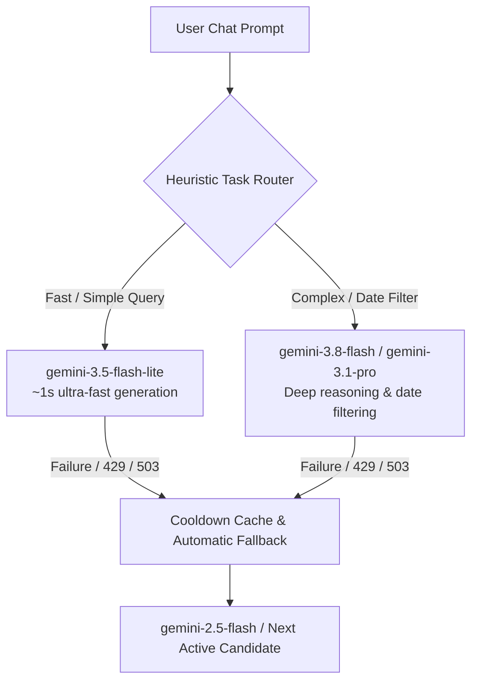

# ✨ SmartClean

<p align="left">
  
  
  
  
  
  
  
  
  
  
  
</p>

**SmartClean** is a modern, privacy-first macOS desktop application designed to eliminate cloud storage and inbox clutter with a single sentence. Instead of clicking through slow filters and endless dropdowns to find duplicates or stale files, SmartClean introduces a **Text-to-Action** paradigm: tell the assistant what you want to clean, and it handles the complex Google Drive and Gmail API operations for you.

Wrapped in a native-feeling macOS "liquid glass" UI, SmartClean acts as an intelligent intermediary between your natural language intentions and cloud storage.

---

### 🌟 What's New in v1.1.0

> [!NOTE]
> **Version 1.1.0** is our most performant, stable, and intelligent release to date.

* 🧠 **Smart AI Model Routing (`Auto` Mode):** Sub-millisecond heuristic task routing that sends simple queries to ultra-fast models (`gemini-3.5-flash-lite`) and complex reasoning/date-filtering tasks to deeper models (`gemini-3.8-flash` / `gemini-3.1-pro-preview`).
* ⚡ **Instant Local Fast-Path (`<10ms` Response):** Common file selection (PDFs, images, music, videos, archives) and deselection queries execute instantly in Python with **0 API quota** and zero token latency.
* 🛡️ **Mathematical Duplicate Engine:** Pre-computes identical file clusters in native Python using exact byte-size matching and normalized filenames, with **100% Original File Protection** and anti-hallucination guardrails.
* ⏳ **Resilient Multi-Model Cooldown Cache:** Automatically handles `429` (Rate Limit), `503` (Overloaded), `400`, and `404` errors with intelligent cooldowns (`MODEL_COOLDOWN_UNTIL`), guaranteeing uninterrupted assistance.
* 📦 **70%+ Context Compaction:** Lightweight JSON payloads cut token usage by more than 70%, drastically accelerating LLM processing for 500-item batches.
* 🌐 **Strict Multilingual Parity:** Dynamic, bias-free language matching ensuring the assistant answers strictly in the user's prompt language (English, Romanian, etc.).

---

## 🚀 Key Features

* **🤖 Text-to-Action AI:** Say *"Select all PDF files"*, *"Find duplicates"*, or *"Select all images older than 2022"*. The assistant parses your request and selects items for your review in seconds.
* **⚡ Instant Local Fast-Path (<10ms):** Simple file-type queries (`PDFs`, `Images`, `Music`, `Videos`, `Archives`) and deselection commands execute locally in Python in under 10ms with zero network hops.
* **🧠 Smart Routing & Live Indicator:** The chat header shows real-time routing status (`Auto • Routing...` ➔ `Auto • gemini-3.5-flash-lite`). Users can also manually pick their preferred model in Settings.
* **🔑 Bring Your Own Key (BYOK):** 100% free-tier compatible. Users bring their free Gemini API key from Google AI Studio. Keys are stored locally on your Mac and scoped per account.
* **🛡️ Safe by Design (Dry-Run First):** SmartClean never deletes files automatically. It marks matching items as selected in the UI so you can inspect them before moving them to the Trash.
* **👯 Deterministic Duplicate Prevention:** Guarantees you never accidentally delete all copies of a file by permanently keeping the original unselected and only selecting redundant copies (`(1)`, `Copy of`).
* **📧 Dual-Agent Drive & Gmail Support:** Seamlessly query Google Drive files and Gmail messages from a single dashboard. The AI automatically switches context based on your intent.
* **💎 Native macOS Glassmorphism:** Built with Tauri and Rust, featuring transparent title bars, vibrant native desktop blur (`window-vibrancy`), and smooth micro-interactions.

---

## 🏗️ Architecture & Performance Deep Dive

### 1. Smart Model Routing (`Auto` Mode) & BYOK Engine

SmartClean operates on a **100% client-side Bring Your Own Key (BYOK)** model. The app communicates directly with Google GenAI using your free Google AI Studio key:



* **Heuristic Classifier (`is_complex_task`):** Evaluates prompts in `<1ms`. Simple conversational commands route to `gemini-3.5-flash-lite`, while date filters (*"older than 2022"*) and deep analysis route to `gemini-3.8-flash`.
* **Adaptive Cooldown Cache (`MODEL_COOLDOWN_UNTIL`):**
  * `404 Not Found` or `400 Invalid Argument`: Model is paused for **1 hour** so invalid endpoints are never retried.
  * `429 Rate Limit` or `503 Overloaded`: Model is paused for **2 minutes** while the request cascades to the next candidate seamlessly.
* **Manual Override:** Select any preferred model (`gemini-3.5-flash-lite`, `gemini-3.8-flash`, `gemini-2.5-flash`, `gemini-3.1-pro-preview`) directly in Settings.

---

### 2. Instant Local Fast-Path (`<10ms` & Zero Quota)

Why call an LLM across the internet for deterministic tasks? SmartClean bypasses the cloud for common, unambiguous commands:

| Command Type | Example Prompts | Engine | Response Time | Token Cost |
| :--- | :--- | :--- | :--- | :--- |
| **Deselect / Clear** | *"deselect all"*, *"debifeaza tot"*, *"clear selection"* | Native Python | **< 5ms** | **0 Tokens** |
| **PDF Selection** | *"select all pdf files"*, *"toate fisierele pdf"* | Local Mime Filter | **< 10ms** | **0 Tokens** |
| **Media Categories** | *"select all images"*, *"select all videos"*, *"muzica"* | Local Ext Filter | **< 10ms** | **0 Tokens** |
| **Archives** | *"select all zip files"*, *"arhive"* | Local Ext Filter | **< 10ms** | **0 Tokens** |
| **Duplicate Selection** | *"find duplicates"*, *"gaseste duplicatele"* | Math Size Engine | **< 15ms** | **0 Tokens** |
| **Complex / Date Queries** | *"select images older than 2022"*, *"find large pdfs"* | Gemini 3 AI | ~1–2s | Compact Tokens |

---

### 3. Safe-by-Design Mathematical Duplicate Engine

Unlike standard AI file organizers that hallucinate "burst shot duplicates" from sequential camera filenames (`_DSC001`, `_DSC002`), SmartClean uses **exact mathematical verification**:

1. **Normalized Fingerprinting:** Normalizes filenames by stripping copy patterns:
   * Regex: `\s*\(\d+\)$`, `^(Copy of |Copia lui )\s*`, `[\s_-]+copy$`
2. **Byte-Size Verification:** Only groups files that have the **exact same byte size** and matching normalized base names.
3. **Original File Protection:** The earliest file in each duplicate cluster is strictly preserved (`original_to_keep`). Only redundant copies are included in `selected_ids`, ensuring you never delete an only copy.

---

## 🛠️ Tech Stack

* **Frontend:** React 19, TypeScript, Vite, Lucide Icons, CSS3 Glassmorphism (`backdrop-filter`)
* **Desktop Runtime:** Tauri 2.0 (Rust) with native macOS Vibrancy overlay
* **Backend Sidecar:** Python 3 + FastAPI compiled into a standalone binary using PyInstaller
* **AI Engine:** Google Gemini API (`google-genai` SDK) via BYOK header injection
* **Cloud APIs:** Google Drive API v3 & Gmail API v1 (Google OAuth 2.0)

---

## 📦 Installation (For End Users)

1. Navigate to the [Releases](https://github.com/saftanoel/smartclean-app/releases) page.
2. Download the latest `SmartClean_1.1.0_aarch64.dmg` (Apple Silicon) or macOS application bundle.
3. Open the `.dmg` and drag **SmartClean** into your `/Applications` folder.
4. Launch the app and authenticate with your Google Account.
5. In **Settings** (or in chat when prompted), enter your free Gemini API key from [Google AI Studio](https://aistudio.google.com/app/apikey).

---

## 💻 Local Development (For Developers)

### Prerequisites
* **Node.js** (v18+)
* **Rust & Cargo** ([Install rustup](https://rustup.rs/))
* **Python** (3.9+)
* **Xcode Command Line Tools** (`xcode-select --install`)

### Setup Instructions

```bash
# 1. Clone repository
git clone https://github.com/saftanoel/smartclean.git
cd smartclean

# 2. Setup Python environment
cd backend
python3 -m venv venv
source venv/bin/activate
pip install -r requirements.txt

# 3. Configure OAuth credentials (backend/core_secrets.py)
# CLIENT_ID = "your_google_client_id.apps.googleusercontent.com"
# CLIENT_SECRET = "your_google_client_secret"
# REDIRECT_URI = "http://localhost:14201/auth/callback"

# 4. Compile the Python sidecar binary
pyinstaller --onefile main.py
mkdir -p ../frontend/src-tauri/binaries
cp dist/main ../frontend/src-tauri/binaries/main-aarch64-apple-darwin
chmod +x ../frontend/src-tauri/binaries/main-aarch64-apple-darwin

# 5. Start development server
cd ../frontend
npm install
npm run tauri dev
```

---

## 📄 License

Distributed under the MIT License. See `LICENSE` for more information.
